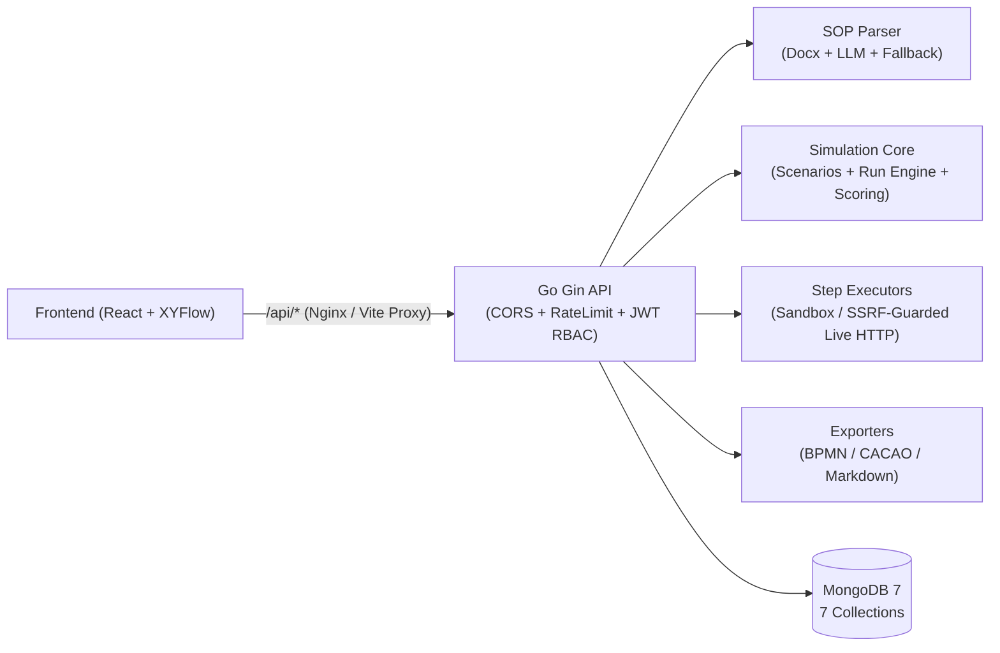

# โครงสร้างโปรเจกต์และหน้าที่ของแต่ละไฟล์ (soc-playbook-engine)

เอกสารนี้สรุปภาพรวมสถาปัตยกรรม โครงสร้างโฟลเดอร์ หน้าที่ของ **ทุกไฟล์** ในโปรเจกต์ ตาราง MongoDB Collections และ API Endpoints ทั้งหมด เพื่อให้ไล่อ่านเข้าใจได้จบในที่เดียว

---

## 1. ภาพรวมการทำงานของระบบ (Architecture Flow)



---

## 2. แผนผังไฟล์ทั้งหมด (Directory Tree)

```text
soc-playbook-engine/
├── .env                         # (สร้างเองที่ root ไม่อยู่ใน git) ค่า config & API keys
├── .gitignore                   # ไฟล์ที่ยกเว้นจาก git (.env, node_modules, dist)
├── .github/
│   └── workflows/
│       └── ci.yml               # GitHub Actions CI (Go fmt/vet/test/build + Frontend lint/test/build)
├── ARCHITECTURE.md              # เอกสารโครงสร้างและหน้าที่ของแต่ละไฟล์ (ไฟล์นี้)
├── README.md                    # คู่มือติดตั้ง วิธีรัน และตาราง Environment Variables
├── docker-compose.yml           # รัน MongoDB (เปิด auth) + Backend + Frontend พร้อมกัน
│
├── backend/                     # Go API & SOC Simulation Engine
│   ├── Dockerfile               # Multi-stage build (golang -> alpine non-root user)
│   ├── go.mod / go.sum          # Go module & dependencies (gin, mongo-driver/v2)
│   ├── main.go                  # จุดเริ่มต้นโปรแกรม: โหลด config, ต่อ Mongo, seed ข้อมูล, เปิดเซิร์ฟเวอร์
│   ├── env_config.go            # โหลด .env และรวม config ทั้งหมดไว้ใน struct AppConfig
│   ├── models.go                # Data models ทั้งหมด (Node, Edge, Playbook, Tool, Scenario, User, Run, Score)
│   ├── middleware.go            # Gin middleware สำหรับ CORS และ per-IP Rate Limiting
│   ├── rate_limit.go            # Token-bucket rate limiter และตัวตรวจ CORS origin (stdlib)
│   ├── auth.go                  # Hash รหัสผ่าน (PBKDF2-SHA256) และสร้าง/ตรวจ HS256 JWT (stdlib)
│   ├── auth_middleware.go       # Middleware ตรวจ Bearer JWT และแยกสิทธิ์ trainee / instructor
│   ├── handlers.go              # REST API: health, config, generate, sops, tools, scenarios, execute, export
│   ├── handlers_sim.go          # REST API: auth (login/register/me) และ simulation runs (start/step/complete)
│   ├── docx_extractor.go        # แกะข้อความและระดับย่อหน้า (indentation) จากไฟล์ .docx และ plain text
│   ├── llm_parser.go            # แปลงข้อความ SOP เป็นขั้นตอนผ่าน Ollama / Hugging Face พร้อม fallback parser
│   ├── flow_builder.go          # แปลงขั้นตอนแบบ tree เป็นกราฟ Nodes/Edges และผูก Tool อัตโนมัติ
│   ├── playbook_versioning.go   # คำนวณเลขเวอร์ชันอัตโนมัติ (v1, v2, ...) และสร้าง snapshot
│   ├── tool_catalog.go          # Built-in tools, validation, slugify, จำกัดชื่อ env_var และ sanitize SOP
│   ├── url_payload_builder.go   # แทนค่าตัวแปร {{alert.*}}/{{prev.*}}, inject auth และ mask secret
│   ├── sandbox_executor.go      # ตัวรันโหมด Sandbox (รองรับ Scenario-driven mock + fallback เดิม)
│   ├── http_executor.go         # ตัวรันโหมด Live HTTP พร้อม SSRF guard, multi-IP fallback และ host allowlist
│   ├── scenario_catalog.go      # 3 Built-in scenarios, validation, ซ่อนเฉลย (StripScenarioAnswers) และหา mock
│   ├── condition_eval.go        # ตัวประเมินเงื่อนไขบน Decision Edge (==, >, contains, is_true ฯลฯ)
│   ├── run_engine.go            # Server-side graph engine ตรวจลำดับโหนด รัน automated/manual step และสร้าง Audit Event
│   ├── scoring.go               # ระบบให้คะแนน 100 คะแนน (Verdict 40 / Coverage 35 / Path 15 / MTTR 10)
│   ├── mongo_repository.go      # MongoDB CRUD ของ playbooks + playbook_versions
│   ├── tool_repository.go       # MongoDB CRUD ของ tools + seed built-in tools
│   ├── scenario_repository.go   # MongoDB CRUD ของ scenarios + seed built-in scenarios
│   ├── user_repository.go       # MongoDB CRUD ของ users + unique username index + seed default users
│   ├── run_repository.go        # MongoDB CRUD ของ runs + append-only run_events พร้อม indexes
│   ├── exporter_bpmn.go         # ส่งออกกราฟเป็นไฟล์ BPMN 2.0 XML
│   ├── exporter_cacao.go        # ส่งออกกราฟเป็นไฟล์ OASIS CACAO JSON
│   ├── exporter_markdown.go     # ส่งออกกราฟเป็น Markdown + Mermaid flowchart
│   └── engine_test.go           # Backend unit tests 28 เคส (parser, auth, SSRF, scenarios, runs, scoring, versioning)
│
└── frontend/                    # React 19 + TypeScript + Tailwind v4 + XYFlow
    ├── Dockerfile               # Multi-stage build (node build -> nginx:alpine)
    ├── nginx.conf               # เสิร์ฟ SPA + proxy /api/ ไป backend (รองรับ upload 11MB, timeout 180s)
    ├── index.html               # HTML root ของแอป
    ├── package.json             # scripts (dev, build, lint, test) และ dependencies
    ├── vite.config.ts           # ตั้งค่า Vite + dev proxy /api -> localhost:8080
    ├── tsconfig*.json           # ตั้งค่า TypeScript (แยก build แอปกับ test files)
    └── src/
        ├── main.tsx             # React entrypoint mount <App />
        ├── index.css            # Tailwind CSS + print styles สำหรับส่งออก PDF
        ├── types.ts             # TypeScript interfaces ทั้งหมดที่ตรงกับ backend/models.go
        ├── api.ts               # REST client พร้อมแนบ Bearer token อัตโนมัติทุก request
        ├── graphLayout.ts       # จัดตำแหน่งโหนดอัตโนมัติด้วย Dagre และข้อความ SOP ตัวอย่าง
        ├── pipeline.ts          # คำนวณสถานะโหนด (ready/locked/skipped) และประเมินเงื่อนไข Decision Edge
        ├── runtimeParams.ts     # จัดการ parameter แบบ fixed/dynamic, shared alert hints และสร้าง URL เปิดเบราว์เซอร์
        ├── toolTemplates.ts     # Quick templates ของ Tool Manager, Smart URL parser และตัวแปลง Mock rows
        ├── App.tsx              # คอมโพเนนต์หลัก เชื่อม state, ReactFlow canvas, auth และ server-run lifecycle
        ├── ExecutionPanel.tsx   # แผงควบคุมการรัน: เลือก Scenario, เริ่ม/ส่งรอบฝึก, Sandbox/Live, Session Keys, Inputs
        ├── FlowNodeCard.tsx     # การ์ดแต่ละโหนดบนกราฟ (badge auth, password input, ปุ่มเปิดเว็บ + ยืนยันผล Manual)
        ├── ToolManagerModal.tsx # หน้าต่างจัดการ Tool Catalog (สร้าง/แก้/ลบ/ทดสอบ Dry Run)
        ├── ToolAuthSection.tsx  # ส่วนตั้งค่า Authentication (.env / Session Key) ภายใน Tool Manager
        ├── LookupPayloadModal.tsx # หน้าต่างตั้งค่า fixed/dynamic payload ของแต่ละโหนด (กรอง secret ออกก่อนเซฟ)
        ├── EdgeConditionModal.tsx # หน้าต่างตั้งค่าเงื่อนไขบนเส้นออกจากโหนด Decision
        ├── AuthModal.tsx        # หน้าต่างเข้าสู่ระบบ (Username/Password) และสมัครบัญชี Trainee
        ├── RunDashboardModal.tsx # หน้าต่างแสดงคะแนน 100 คะแนน, ประวัติรอบฝึก (Trainee/Instructor) และ Audit Timeline
        ├── pipeline.test.ts     # Unit tests ของเงื่อนไข Decision และการล็อก/ข้ามกิ่งใน pipeline.ts
        ├── runtimeParams.test.ts # Unit tests ของการแยก param, isSecret และ buildNodeResolvedUrl
        └── toolTemplates.test.ts # Unit tests ของ slugifyName, parseSmartUrl และ mockRowsToObject
```

---

## 3. รายละเอียดหน้าที่ของแต่ละไฟล์

### 3.1 Root, Docker & CI

| ไฟล์ | หน้าที่หลัก |
|---|---|
| `docker-compose.yml` | รัน 3 services (`mongodb`, `backend`, `frontend`), เปิด MongoDB root authentication, จำกัด port `27017` เฉพาะ `127.0.0.1` และเช็ก healthcheck ก่อนสตาร์ท backend |
| `.github/workflows/ci.yml` | รันอัตโนมัติเมื่อ push/PR: ฝั่ง Go ตรวจ `gofmt`, `go vet`, `go test -race`, `go build`; ฝั่ง Frontend ตรวจ `npm ci`, `oxlint`, `npm test`, `tsc -b && vite build` |
| `README.md` | คู่มือเริ่มต้นใช้งาน วิธีรัน Docker/Local และตารางตัวแปร `.env` |
| `.env` *(ไม่อยู่ใน git)* | วางไว้ที่ root ระดับเดียวกับ `backend/` และ `frontend/` เพื่อเก็บ MongoDB password, LLM config, `AUTH_ENABLED`, `AUTH_SECRET`, `ALLOW_LIVE_EXECUTION` และ tool API keys |

### 3.2 Backend (`backend/`)

#### A. Entry, Config, Security & Auth
| ไฟล์ | หน้าที่หลัก |
|---|---|
| [`main.go`](./backend/main.go) | โหลด config → เชื่อม MongoDB → สร้าง indexes & seed ข้อมูลเริ่มต้น (tools, scenarios, users) → ตั้ง `TrustedProxies` + `CORSMiddleware` → เปิด Gin server |
| [`env_config.go`](./backend/env_config.go) | อ่าน `.env` (ทั้ง `./.env` และ `../.env`) และ map เป็น `Config` (`AppConfig`) |
| [`models.go`](./backend/models.go) | รวม JSON/BSON structs ของทั้งระบบ: Playbook, Version Snapshot, Node, Edge/EdgeCondition, Tool/ToolAuth, Scenario/GroundTruth, User, AuthClaims, SimulationRun, RunEvent, RunScore |
| [`rate_limit.go`](./backend/rate_limit.go) | `IPRateLimiter` (token bucket ต่อ IP ใน memory) และ `IsOriginAllowed` สำหรับ CORS (ใช้ Go stdlib ล้วน) |
| [`middleware.go`](./backend/middleware.go) | Gin middleware ห่อ `CORSMiddleware` และ `RateLimitMiddleware` |
| [`auth.go`](./backend/auth.go) | Hash/ตรวจรหัสผ่านด้วย **PBKDF2-SHA256** (210,000 iterations + random salt), สร้าง/ตรวจ **HS256 JWT** และ validate username/password/role (stdlib ล้วน) |
| [`auth_middleware.go`](./backend/auth_middleware.go) | ตรวจ `Authorization: Bearer <token>` และบังคับสิทธิ์ `instructor` (เปิด/ปิดได้ด้วย `AUTH_ENABLED`) |

#### B. API Handlers
| ไฟล์ | หน้าที่หลัก |
|---|---|
| [`handlers.go`](./backend/handlers.go) | ลงทะเบียน routes ทั้งหมด และจัดการ `/api/health`, `/api/config`, `/api/generate`, `/api/sops` (+ `/versions`), `/api/tools`, `/api/scenarios` (ซ่อนเฉลยอัตโนมัติสำหรับ trainee), `/api/execute`, `/api/export/*` |
| [`handlers_sim.go`](./backend/handlers_sim.go) | จัดการ `/api/auth/login`, `/api/auth/register`, `/api/auth/me` และวงจรชีวิต Simulation Run: `POST /api/runs`, `GET /api/runs`, `GET /api/runs/:id`, `POST /api/runs/:id/steps/:nodeId`, `POST /api/runs/:id/complete` |

#### C. SOP Parser, Flowchart Builder & Versioning
| ไฟล์ | หน้าที่หลัก |
|---|---|
| [`docx_extractor.go`](./backend/docx_extractor.go) | อ่านไฟล์ Word `.docx` (ZIP + XML) หรือข้อความธรรมดา แยกออกมาเป็น `[]Line` พร้อมระดับ indentation |
| [`llm_parser.go`](./backend/llm_parser.go) | สร้าง dynamic prompt จากรายการ Tools ที่เปิดใช้งาน → ส่งไป Ollama หรือ Hugging Face → ถ้า LLM ล่มจะ fallback มาใช้ `ParseLinesByIndentation` อัตโนมัติ |
| [`flow_builder.go`](./backend/flow_builder.go) | แปลง `[]Step` เป็นกราฟ `[]Node` + `[]Edge`, ใส่ Start/End node, ตัด orphan end node และเติม default payload ของ tool |
| [`playbook_versioning.go`](./backend/playbook_versioning.go) | เพิ่มเลข `Version` อัตโนมัติทุกครั้งที่บันทึก Playbook และสร้าง `PlaybookVersionSnapshot` แบบ immutable |

#### D. Tools, Auth Resolution & Step Executors
| ไฟล์ | หน้าที่หลัก |
|---|---|
| [`tool_catalog.go`](./backend/tool_catalog.go) | นิยาม Built-in Tools (`virustotal`, `abuseipdb`, `jira_search`, `firewall_block`, `ticket`), normalize legacy ID (`jira_ticket` → `ticket`), ตรวจ `IsAllowedToolAuthEnvVar` (กันขโมย `MONGO_URI`/`HF_TOKEN`), และ `SanitizePlaybookForSave` ล้าง runtime input & secrets ก่อนเซฟลง DB |
| [`url_payload_builder.go`](./backend/url_payload_builder.go) | แทนค่า template `{{alert.*}}`, `{{prev.*}}`, `{{nodes.*}}`, แยกค่าสำหรับแสดงผล (mask secret เป็น `***` ทั้ง path/query/header/body) กับค่าจริงสำหรับยิง HTTP และ resolve `ToolAuth` (`.env` → `runtime_auth`) |
| [`sandbox_executor.go`](./backend/sandbox_executor.go) | รันขั้นในโหมด Sandbox: ดึง mock จาก Scenario ก่อน (match target → `default`) แล้วค่อย fallback ไป mock เดิมของ tool |
| [`http_executor.go`](./backend/http_executor.go) | รันขั้นในโหมด Live HTTP (`ALLOW_LIVE_EXECUTION=true`): ป้องกัน SSRF (บล็อก loopback/private/link-local/metadata/CGNAT + DNS rebinding + redirect guard + `LIVE_ALLOWED_HOSTS` + multi-IP IPv6→IPv4 fallback) |

#### E. Simulation Core (Scenarios, Conditions, Run Engine & Scoring)
| ไฟล์ | หน้าที่หลัก |
|---|---|
| [`scenario_catalog.go`](./backend/scenario_catalog.go) | นิยาม 3 โจทย์ฝึกตั้งต้น (`ssh_brute_force_tp`, `internal_scanner_fp`, `phishing_url_manual`), validate ข้อมูล, `StripScenarioAnswers` ซ่อนเฉลย/mock และ `ResolveScenarioMockOutput` |
| [`condition_eval.go`](./backend/condition_eval.go) | ประเมินเงื่อนไข `EdgeCondition` (`==`, `!=`, `>`, `>=`, `<`, `<=`, `contains`, `is_true`, `is_false`) บน `prev.*`/`alert.*`/`nodes.*` และ fallback ไป heuristic เดิมถ้าไม่ได้ตั้งเงื่อนไข |
| [`run_engine.go`](./backend/run_engine.go) | คำนวณสถานะกราฟฝั่ง server (`ComputeRunGraphState`) ป้องกันการข้ามโหนดที่ล็อก, รันทั้ง automated step และ manual verdict (`clean`/`suspicious`/`malicious`/`done`) และ mask secret input ก่อนลง `RunEvent` |
| [`scoring.go`](./backend/scoring.go) | คำนวณคะแนน 0–100: Verdict Accuracy (40) + Step Coverage (35) + Decision Path (15) + MTTR Speed (10) พร้อมรายการโหนดที่พลาดและ feedback ภาษาไทย |

#### F. MongoDB Repositories, Exporters & Tests
| ไฟล์ | หน้าที่หลัก |
|---|---|
| [`mongo_repository.go`](./backend/mongo_repository.go) | จัดการ collection `playbooks` และ `playbook_versions` (พร้อม unique index `(playbook_id, version)`) |
| [`tool_repository.go`](./backend/tool_repository.go) | จัดการ collection `tools`, migrate `jira_ticket` → `ticket`, backfill params/auth และป้องกันการลบ built-in tools |
| [`scenario_repository.go`](./backend/scenario_repository.go) | จัดการ collection `scenarios`, seed 3 โจทย์ตั้งต้น และป้องกันการลบ built-in scenarios |
| [`user_repository.go`](./backend/user_repository.go) | จัดการ collection `users`, สร้าง unique index บน `username` และ seed บัญชี `instructor` / `trainee` |
| [`run_repository.go`](./backend/run_repository.go) | จัดการ collection `runs` และ append-only `run_events` พร้อม indexes |
| [`exporter_bpmn.go`](./backend/exporter_bpmn.go) | แปลงกราฟเป็น BPMN 2.0 XML |
| [`exporter_cacao.go`](./backend/exporter_cacao.go) | แปลงกราฟเป็น OASIS CACAO Playbook JSON |
| [`exporter_markdown.go`](./backend/exporter_markdown.go) | แปลงกราฟเป็น Markdown + Mermaid diagram |
| [`engine_test.go`](./backend/engine_test.go) | Unit tests 28 เคส ครอบคลุม parser, builder, CACAO export, tool auth, secret masking, SSRF, rate limiter, scenarios, structured conditions, PBKDF2/JWT, server run engine, scoring และ playbook versioning |

---

### 3.3 Frontend (`frontend/`)

| ไฟล์ | หน้าที่หลัก |
|---|---|
| [`main.tsx`](./frontend/src/main.tsx) | จุดเริ่มต้น React mount `<App />` |
| [`index.css`](./frontend/src/index.css) | Tailwind CSS v4 และกฎ `@media print` สำหรับพิมพ์/ส่งออก PDF |
| [`types.ts`](./frontend/src/types.ts) | รวม TypeScript types ทั้งหมดของ Playbook, Version, Tool, Scenario, AuthUser, SimulationRun, RunEvent, RunScore |
| [`api.ts`](./frontend/src/api.ts) | ฟังก์ชันเรียก backend API ทั้งหมด ผ่าน `authFetch` ที่แนบ `Authorization: Bearer <token>` จาก `localStorage` อัตโนมัติ |
| [`graphLayout.ts`](./frontend/src/graphLayout.ts) | คำนวณพิกัดกราฟบน-ล่างด้วย `@dagrejs/dagre`, format เงื่อนไขบนป้าย edge และเก็บ `SAMPLE_SOP` |
| [`pipeline.ts`](./frontend/src/pipeline.ts) | Mirror logic ฝั่ง frontend ของ `EvaluateEdgeCondition`, `pickDecisionEdge` และ `computePipelineState` (ready/locked/skipped) |
| [`runtimeParams.ts`](./frontend/src/runtimeParams.ts) | แยก parameter ของแต่ละโหนด (fixed vs dynamic vs pipe vs secret), จับคู่ shared alert keys และสร้าง URL เปิดเว็บสำหรับ Manual Node |
| [`toolTemplates.ts`](./frontend/src/toolTemplates.ts) | Quick templates สร้าง Tool (รวม Web Check Anti-bot), `parseSmartUrl` แยก path/query อัตโนมัติ และแปลง Mock KV rows ↔ JSON |
| [`App.tsx`](./frontend/src/App.tsx) | คอมโพเนนต์หลัก คุม state ของ Playbook, ReactFlow canvas, Auth, กู้คืนรอบฝึกหลัง refresh (`sessionStorage`), รันทีละขั้น / รันต่อหลัง manual node และเชื่อม Modals ทั้งหมด |
| [`ExecutionPanel.tsx`](./frontend/src/ExecutionPanel.tsx) | แผงด้านซ้ายสำหรับการรัน: เลือก Training Scenario, ปุ่มเริ่ม/ส่งคำตอบ Server Run, สวิตช์ Sandbox/Live, ช่องกรอก Session API Keys, ช่อง Alert/Step Inputs และปุ่ม Run All / Resume / Reset |
| [`FlowNodeCard.tsx`](./frontend/src/FlowNodeCard.tsx) | การ์ดโหนดแต่ละประเภทบนกราฟ แสดง badge (`🌐 MANUAL`, `🔑 .env`, `🔑 Session`, `🔑 Missing`), input แบบ password สำหรับ secret, ปุ่ม `↗ เปิดเว็บ` และปุ่มยืนยันผล (`✓ ปกติ` / `⚠ เสี่ยง` / `✓ ทำแล้ว`) |
| [`ToolManagerModal.tsx`](./frontend/src/ToolManagerModal.tsx) | หน้าต่างจัดการ Tool Catalog: ค้นหา, สร้างจาก template, สลับโหมด API / เปิดเว็บตรวจเอง, ตั้งค่า params (`is_secret`), mock output และ Dry Run test |
| [`ToolAuthSection.tsx`](./frontend/src/ToolAuthSection.tsx) | กล่องตั้งค่า Authentication (`none` / `api_key` / `bearer` / `basic`, `env_var`, `allow_runtime`) ภายใน Tool Manager |
| [`LookupPayloadModal.tsx`](./frontend/src/LookupPayloadModal.tsx) | หน้าต่างปรับแต่ง payload ของแต่ละโหนด (เลือก fixed/dynamic แยกรายพารามิเตอร์ และตัด secret ทิ้งไม่ให้เซฟลง SOP) |
| [`EdgeConditionModal.tsx`](./frontend/src/EdgeConditionModal.tsx) | หน้าต่างตั้งค่าเงื่อนไขแบบมีโครงสร้างเมื่อคลิกที่เส้นออกจากโหนด Decision |
| [`AuthModal.tsx`](./frontend/src/AuthModal.tsx) | หน้าต่าง Login ด้วย Username/Password และสมัครบัญชี Trainee |
| [`RunDashboardModal.tsx`](./frontend/src/RunDashboardModal.tsx) | หน้าต่างดูผลคะแนน 100 คะแนน (แยก 4 หมวด), ตารางผลฝึกของ Trainee / Instructor, ปุ่มทำต่อจากจุดที่ค้าง และ Audit Event Timeline |
| `*.test.ts` (3 ไฟล์) | Unit tests รันด้วย `npm test` (`node --test`) สำหรับ `pipeline.ts`, `runtimeParams.ts` และ `toolTemplates.ts` |
| [`nginx.conf`](./frontend/nginx.conf) | Config ของ Nginx ใน Docker: เสิร์ฟ static build, fallback SPA และ proxy `/api/` (รองรับ `.docx` 11MB, timeout 180s) |

---

## 4. MongoDB Collections & Indexes

| Collection | ข้อมูลที่เก็บ | Indexes |
|---|---|---|
| `playbooks` | SOP Playbook เวอร์ชันล่าสุด (`version`, `nodes`, `edges`) | `_id` |
| `playbook_versions` | Snapshot ทุกเวอร์ชันของ Playbook (immutable) | `(playbook_id, version DESC)` unique |
| `tools` | Built-in และ Custom Tools (พร้อม `auth` metadata — ไม่เก็บ secret จริง) | `_id` |
| `scenarios` | โจทย์ฝึกจำลอง (`alert`, `tool_mocks`, `ground_truth`) | `_id` |
| `users` | บัญชีผู้ใช้ (`username`, `role`, `password_hash` PBKDF2-SHA256) | `username` unique |
| `runs` | สถานะรอบฝึกของแต่ละคน (snapshot กราฟ, ผลแต่ละโหนด, คะแนน) | `(trainee_id, started_at DESC)`, `(scenario_id, started_at DESC)` |
| `run_events` | Append-only Audit Log ทุกการกระทำในรอบฝึก | `(run_id, seq ASC)` unique |

---

## 5. API Endpoints & RBAC Matrix

| ระดับสิทธิ์ | Endpoints |
|---|---|
| **Public** | `GET /api/health`, `GET /api/config`, `POST /api/auth/login`, `POST /api/auth/register` (สร้างได้เฉพาะ `trainee` ยกเว้น instructor เรียก) |
| **Authenticated (`trainee` & `instructor`)** | `GET /api/auth/me`, `GET /api/sops`, `GET /api/sops/:id/versions`, `GET /api/tools`, `GET /api/scenarios` *(ซ่อนเฉลยอัตโนมัติสำหรับ trainee)*, `GET /api/scenarios/:id`, `POST /api/runs`, `GET /api/runs`, `GET /api/runs/:id`, `POST /api/runs/:id/steps/:nodeId`, `POST /api/runs/:id/complete`, `POST /api/execute` *(Live mode จำกัดเฉพาะ instructor)*, `POST /api/export/{bpmn,cacao,markdown}` |
| **Instructor Only** *(เมื่อ `AUTH_ENABLED=true`)* | `POST /api/generate`, `POST /api/sops`, `DELETE /api/sops/:id`, `POST/PUT/DELETE /api/tools*`, `POST /api/tools/test`, `POST/PUT/DELETE /api/scenarios*` |

---

## 6. แนะนำลำดับการไล่อ่านโค้ด (Reading Order)

ถ้าต้องการไล่อ่านโปรเจกต์ตั้งแต่ต้นจนจบ แนะนำตามลำดับ 6 ก้าวนี้ครับ:
1. **Data Models:** [`backend/models.go`](./backend/models.go) และ [`frontend/src/types.ts`](./frontend/src/types.ts) — เห็นโครงสร้างข้อมูลทั้งหมดใน 5 นาที
2. **SOP → Flowchart:** [`docx_extractor.go`](./backend/docx_extractor.go) → [`llm_parser.go`](./backend/llm_parser.go) → [`flow_builder.go`](./backend/flow_builder.go)
3. **Tools & Execution Security:** [`tool_catalog.go`](./backend/tool_catalog.go) → [`url_payload_builder.go`](./backend/url_payload_builder.go) → [`sandbox_executor.go`](./backend/sandbox_executor.go) → [`http_executor.go`](./backend/http_executor.go)
4. **SOC Simulation Core:** [`scenario_catalog.go`](./backend/scenario_catalog.go) → [`condition_eval.go`](./backend/condition_eval.go) → [`run_engine.go`](./backend/run_engine.go) → [`scoring.go`](./backend/scoring.go)
5. **Auth & API Routing:** [`auth.go`](./backend/auth.go) → [`auth_middleware.go`](./backend/auth_middleware.go) → [`handlers.go`](./backend/handlers.go) → [`handlers_sim.go`](./backend/handlers_sim.go)
6. **Frontend Flow:** [`api.ts`](./frontend/src/api.ts) → [`pipeline.ts`](./frontend/src/pipeline.ts) → [`App.tsx`](./frontend/src/App.tsx) → [`ExecutionPanel.tsx`](./frontend/src/ExecutionPanel.tsx) → [`FlowNodeCard.tsx`](./frontend/src/FlowNodeCard.tsx) → [`RunDashboardModal.tsx`](./frontend/src/RunDashboardModal.tsx)
